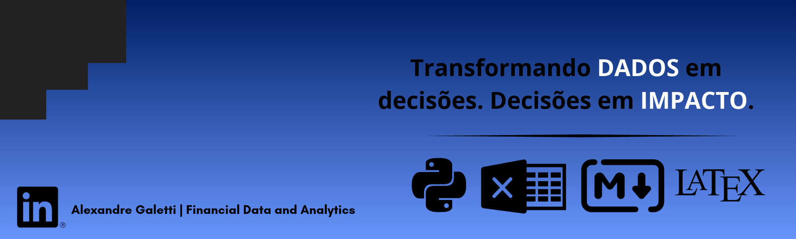

## Hi there!👋🏻 I'm Alexandre




---

<div align="center">
  
[](#) [](#) [](#) [](#) [](#) [](#) 


## Data • Finance • Analytics • Technology

[About me](#-about-me) | [Tech Box](#-tech-box) | [Projects](#-projects) | [Contact](#-contact)

</div>

---

## 😎 About me

I'm a professional transitioning into `data-driven` and `technology-focused` roles, currently `developing projects` involving:

* Python 🐍
* Data Analytics 📊
* Risk Management Models 🧗‍♂️
* Brazilian Bonds and Derivatives Pricing Models💲

---

## 🧰 Tech Box

### Languages
```python
* Python
* HTML/CSS
* Markdown
* LaTeX
```

---

## 💻 Projects

```python
* Financial Engineering
* Mathematics
* Physics
* Economics
```

👉 You can check my work [here](https://github.com/MSGamgee85/Projetos).

---

## 📫 Contact

- LinkedIn: [linkedin.com/in/alexandre-galetti](https://linkedin.com/in/alexandre-galetti)
- GitHub: [github.com/MSGamgee85](https://github.com/MSGamgee85)
- E-mail: alexandre.galetti@gmail.com

---
<div align="center">
  
⭐ ```"Always learning, building and improving."```


</div>
                                                                                                  
